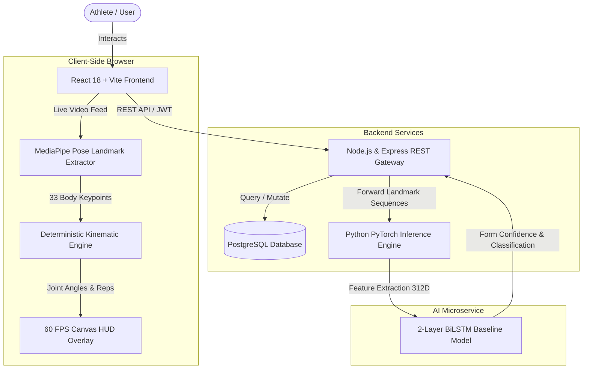

# MOV-IQ — Move Smarter. Get Stronger. 🏋️‍♂️⚡

[](https://opensource.org/licenses/MIT)
[](https://nodejs.org/)
[](https://react.dev/)
[](https://vitejs.dev/)
[](https://www.postgresql.org/)
[](https://pytorch.org/)
[](https://developers.google.com/mediapipe)

**MOV-IQ** is a consumer-grade, full-stack fitness and strength-training application with real-time **AI-powered exercise form analysis**. It combines high-precision workout logging, custom routine architecture, and interactive anatomical visualizations with an on-device/microservice deep learning pipeline for kinematic feedback.

---

## 🌟 Key Features

- **🏋️ 1,340+ Master Exercise Catalog**: Comprehensive exercise library with muscle targeting (primary & secondary), equipment filters, and multi-lingual instruction guides.
- **🤖 Real-Time AI Form Assistance**:
  - **Client-Side Kinematics**: MediaPipe Pose (33 3D landmarks) running at 60 FPS directly in the browser for privacy-first skeleton tracking.
  - **Deterministic Rep State Machine**: Biomechanical joint angle tracking for rep transitions and depth detection.
  - **Deep Learning Sequence Classifier**: Multi-task Bidirectional LSTM (`best_model.pt`) evaluating exercise identity and binary form correctness (`proper_form` vs `incorrect_form`) with sub-15ms inference latency.
- **📊 Dynamic Workout Logging**: Fast set tracking (reps, weight, RPE, rest timers, set types: Normal, Warmup, Drop Set, Failure).
- **📋 Routine Architecture**: Build, edit, and organize multi-day training splits and routines with drag-and-drop support.
- **📈 Advanced Progress Analytics**: Muscle group volume heatmaps, streak tracking, workout frequency metrics, and volume progression charts.
- **🔒 Privacy by Design**: All camera feeds are processed in-browser. Zero raw video or images are stored or transmitted.

---

## 🏗️ System Architecture



---

## 📁 Repository Structure

```
GYM-TRACKER2/
├── client/                     # React 18 + Vite Frontend Application
│   ├── public/                 # Static assets & brand icons
│   └── src/
│       ├── ai/                 # Client-side kinematics & rep counters
│       ├── components/         # Reusable UI & HUD overlay components
│       ├── context/            # Auth & Workout state management
│       ├── layouts/            # Layout wrappers & navigation
│       ├── pages/              # Views (Dashboard, Workout, Routines, Exercises)
│       └── services/           # Axios API connectors
├── server/                     # Node.js / Express REST API Gateway
│   ├── config/                 # PostgreSQL pool connection
│   ├── controllers/            # Auth, workouts, routines, exercises, AI controllers
│   ├── middleware/             # JWT auth & validation guards
│   ├── routes/                 # API endpoint routers
│   └── seed/                   # Database seeder scripts & exercise catalog
├── Mov-IQ/
│   └── ai_service/             # Standalone Python AI Inference Microservice
│       ├── checkpoints/        # PyTorch trained model weights (best_model.pt)
│       ├── config/             # Model & preprocessing configuration
│       ├── mov_iq/             # Feature pipeline & inference library
│       └── server.py           # Threading HTTP inference server (Port 8000)
├── database/                   # PostgreSQL schema definitions & migrations
├── docs/                       # Engineering specifications & model reports
├── ATTRIBUTIONS.md             # Third-party licensing & copyright acknowledgments
├── LICENSE                     # MIT License
└── package.json                # Monorepo task orchestration
```

---

## 🚀 Quick Start Guide

### Prerequisites
- **Node.js** (v18.0.0 or higher) & **npm**
- **Python** (v3.9 or higher) with `pip`
- **PostgreSQL** (v14 or higher) running locally on port 5432

---

### 1. Database Setup

1. Create a PostgreSQL database named `fitness_app`:
   ```bash
   # In psql or PostgreSQL GUI:
   CREATE DATABASE fitness_app;
   ```
2. Configure `.env` in the root directory (refer to `.env.example`):
   ```env
   PORT=5000
   DB_HOST=localhost
   DB_PORT=5432
   DB_NAME=fitness_app
   DB_USER=postgres
   DB_PASSWORD=your_password
   JWT_SECRET=your_jwt_secret_key
   CLIENT_URL=http://localhost:5173
   ```
3. Initialize tables and seed the master exercise catalog:
   ```bash
   node database/setup.js
   node server/seed/seedExercises.js
   ```

---

### 2. Backend Server

```bash
cd server
npm install
npm run dev
# Server listens on http://localhost:5000
```

---

### 3. AI Inference Microservice

```bash
cd Mov-IQ/ai_service
pip install -r requirements.txt
python server.py --port 8000
# Inference microservice listens on http://localhost:8000
```

---

### 4. Frontend Client

```bash
cd client
npm install
npm run dev
# Vite dev server starts at http://localhost:5173
```

---

## 📜 Intellectual Property, Licensing & Copyright

MOV-IQ is strictly committed to transparent open-source standards and intellectual property compliance:

- **Application Code & Architecture**: Licensed under the **[MIT License](LICENSE)** &copy; 2026 Bhargav Kilari.
- **Exercise Metadata & Instructions**: Licensed under the MIT License by upstream maintainer Hasan Eydlrm ([exercises-dataset](https://github.com/hasaneyldrm/exercises-dataset)).
- **Exercise Visuals & Demonstration Media**:
  - All exercise demonstration animations and thumbnails remain the intellectual property and copyright of **[Gym Visual](https://gymvisual.com/)**.
  - All views rendering exercise media prominently feature the attribution: `© Gym visual — https://gymvisual.com/`.
  - MOV-IQ does **not** claim ownership of Gym Visual media and does not redistribute or re-license proprietary assets under the MIT license.
- Detailed notices and dependencies are itemized in **[ATTRIBUTIONS.md](ATTRIBUTIONS.md)**.

---

## 👤 Author

Developed by **Bhargav Kilari**  
GitHub: [@Bhargav-kilari](https://github.com/Bhargav-kilari)  
Woxsen University — Deep Learning & Applied AI
